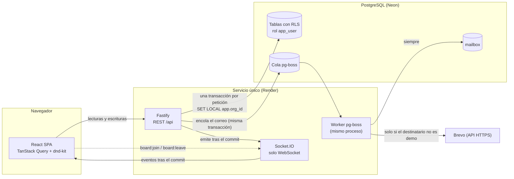

# Tablero Kanban en tiempo real

SaaS multi-organización de tableros Kanban con arrastrar y soltar, WebSockets, comentarios con menciones y avisos en la app y por correo. Proyecto de curso y de portafolio, hecho solo con TypeScript y planes gratuitos.

[](https://github.com/<usuario>/<repo>/actions/workflows/ci.yml)

> La insignia y el enlace de la demo llevan marcadores (`<usuario>/<repo>`, `<tu-app>`) hasta que el repositorio y el servicio estén publicados.

## Demo

**`https://<tu-app>.onrender.com`** — _pendiente de publicar_ (los pasos están en [`docs/despliegue.md`](docs/despliegue.md)).

- Es el plan gratuito de Render: el servicio **se duerme tras ~15 min sin visitas y la primera carga tarda ~1 minuto**. Después va con normalidad.
- En la pantalla de entrada hay botones «Entrar como …» (sin contraseña). Usuarios de demo:

| Usuario     | Correo             | Organización | Papel          |
| ----------- | ------------------ | ------------ | -------------- |
| Ana López   | `ana@demo.local`   | Estudio Acme | Administradora |
| Luis García | `luis@demo.local`  | Estudio Acme | Miembro        |
| Marta Ruiz  | `marta@demo.local` | Estudio Acme | Miembro        |
| Pablo Sanz  | `pablo@demo.local` | Otra Empresa | Administrador  |

- **La demo se reinicia cada día** (borra todo, también las cuentas que se registren, y vuelve a cargar los datos de ejemplo). Los usuarios de demo no pueden borrar proyectos, quitar miembros ni cambiar papeles.

## Guion de prueba

Cinco pasos, unos minutos. Al final de cada uno, qué punto de la lista del curso demuestra (ver [Qué cumple](#qué-cumple)).

1. **Tiempo real.** Abre la demo en dos ventanas: en una «Entrar como Ana» y en la otra (incógnito) «Entrar como Luis». Abre el proyecto «Web corporativa» en las dos y mueve una tarjeta en la de Ana: se mueve sola en la de Luis. → _2 y 4_
2. **Tarjetas y columnas.** Crea, edita y borra una tarjeta. Añade una columna, renómbrala, arrástrala para reordenarla y bórrala (si tiene tarjetas, te pregunta a qué columna moverlas). → _2 y 3_
3. **Menciones y avisos.** Como Ana, abre una tarjeta y comenta escribiendo `@Lu` y elige a Luis en la lista que aparece (la mención se guarda con su id, no como texto). En la ventana de Luis sube la campana; ábrela y pulsa el aviso. Luego, en el menú de usuario → «Mi buzón», verás el correo («… te ha mencionado en …», con la etiqueta «Solo buzón (demo)»). → _5 y 6_
4. **Aislamiento.** Entra como Pablo («Otra Empresa»): no ves nada de Estudio Acme. Si copias la dirección de un tablero de Acme (`/o/<id>/p/<id>`) y la abres, ves el error «Esta organización no existe o no tienes acceso a ella.» con un enlace a tu propia organización; la de un tablero de tu organización que no existe da «Este proyecto no existe o no tienes acceso a él.». → _1_
5. **(Opcional) Correo de verdad.** Regístrate con tu correo real, crea tu organización e invita a otra dirección tuya: el enlace aparece en pantalla y te llega por correo. Regístrate con esa segunda dirección, acepta y menciónala: también recibe el aviso por correo (si el servidor tiene Brevo activado). → _1 y 6_

## Qué cumple

| #   | Punto de la lista                              | Dónde está                                                                                                                                                                               | Cómo se prueba                                                              |
| --- | ---------------------------------------------- | ---------------------------------------------------------------------------------------------------------------------------------------------------------------------------------------- | --------------------------------------------------------------------------- |
| 1   | Arquitectura multi-tenant                      | `apps/api/src/db/tx.ts`, `apps/api/src/http/org-guard.ts`, `apps/api/src/db/migrations/0001_rls.sql` ([cómo funciona](#aislamiento-multi-tenant))                                        | `apps/api/test/isolation.test.ts`, `rls.test.ts`, `system-db-usage.test.ts` |
| 2   | Kanban con arrastrar y soltar y CRUD de tareas | `apps/web/src/features/board/` (dnd-kit: ratón, táctil y teclado), `apps/api/src/modules/cards/`                                                                                         | `cards.test.ts`, `neighbours.test.ts`, e2e `realtime.spec.ts`               |
| 3   | Columnas configurables                         | `apps/api/src/modules/columns/`, `apps/web/src/features/board/Column.tsx` (crear, renombrar, reordenar, borrar moviendo las tarjetas)                                                    | `columns.test.ts`, e2e `columns.spec.ts`                                    |
| 4   | Tiempo real con WebSockets                     | `apps/api/src/realtime/` (Socket.IO), `apps/web/src/features/board/useBoardRealtime.ts` ([detalles](#tiempo-real))                                                                       | `realtime.test.ts`, e2e `realtime.spec.ts`                                  |
| 5   | Comentarios y menciones                        | `apps/api/src/modules/comments/`, `packages/shared/src/mentions.ts`, `apps/web/src/features/comments/`                                                                                   | `comments.test.ts`, e2e `mentions.spec.ts`                                  |
| 6   | Notificaciones en la app y por correo          | `apps/api/src/modules/notifications/`, `apps/api/src/modules/mail/` (cola, buzón, Brevo), `apps/web/src/features/notifications/`, `apps/web/src/features/mailbox/` ([detalles](#correo)) | `notifications.test.ts`, `mail.test.ts`, e2e `mentions.spec.ts`             |
| 7   | Aplicación desplegada con demo                 | `render.yaml`, `docs/despliegue.md`, `apps/api/src/modules/demo/` (seed, botones, reinicio diario). **Pendiente de publicar**: enlace en [Demo](#demo)                                   | Lista «Verificación tras publicar» en `docs/despliegue.md`                  |

## Arquitectura

Monorepo con pnpm workspaces: `apps/web` (React + Vite + Tailwind + TanStack Query + dnd-kit), `apps/api` (Fastify + Socket.IO + Drizzle ORM + pg-boss), `packages/shared` (esquemas Zod y tipos de eventos usados por los dos lados) y `e2e` (Playwright). En producción la API sirve también la web compilada: **un solo servicio, mismo origen**, sin CORS.



Las escrituras van **solo por REST**; el socket solo lleva eventos del servidor al navegador (más `board:join` y `board:leave`). Más detalle del diseño en [`docs/superpowers/specs/2026-11-18-tablero-kanban-design.md`](docs/superpowers/specs/2026-11-18-tablero-kanban-design.md).

## Aislamiento multi-tenant

Una base de datos compartida; toda tabla con datos de una organización lleva `organization_id`. Hay **dos barreras independientes**:

1. **La aplicación.** Cada ruta lleva la organización (`/api/orgs/:orgId/...`); un guard comprueba la membresía y el papel, y todo id que llega en el cuerpo (columna, asignado, mencionado, etiqueta) se verifica contra esa organización. Un recurso de otra organización responde **404** (nunca se revela que existe); la falta de permiso, 403.
2. **La base de datos (RLS).** La API se conecta con el rol **`app_user`, que no es dueño de ninguna tabla** y no tiene `BYPASSRLS`. Cada petición abre una transacción y fija `app.user_id` y `app.org_id` con `set_config(..., true)` (equivale a `SET LOCAL`); las políticas filtran por `organization_id = current_setting('app.org_id')`. Si el código olvidara un filtro, la base de datos tampoco devolvería filas de otra organización.

**RLS `ENABLE`, no `FORCE` (decisión).** El diseño inicial hablaba de `FORCE ROW LEVEL SECURITY`. Se dejó en `ENABLE` porque el dueño de las tablas (el rol que migra) es el que usa `systemDb` para las operaciones de sistema, que no pertenecen a ninguna organización. El runtime, `app_user`, no es dueño, así que **las políticas se le aplican siempre**; `FORCE` solo añadiría restricciones al dueño. El riesgo se traslada a «quién puede usar `systemDb`», y eso lo vigila un test.

**Excepciones: dónde se usa `systemDb`** (pool con el rol dueño, salta la RLS). Solo en código que, por naturaleza, está fuera de una organización:

- `modules/auth/`: sesiones, usuarios y búsqueda de membresías al iniciar sesión.
- `modules/invitations/service.ts`: quien acepta una invitación todavía no es miembro.
- `modules/mail/`: cola, buzón (por dirección de email, no por usuario) y cuotas diarias.
- `modules/demo/`: seed y reinicio de la demo.
- `db/client.ts` (su definición) y las migraciones.

`apps/api/test/system-db-usage.test.ts` recorre el código fuente y falla si cualquier otro fichero importa `systemDb`.

**Batería de aislamiento** (`apps/api/test/isolation.test.ts`): recorre **todas las rutas registradas** que llevan un id y comprueba que Pablo (organización B) recibe 404 al usarlas contra recursos de Ana (A), con una foto de la base de datos antes y después para probar que no cambió nada. Incluye controles positivos (los mismos casos funcionan para un usuario legítimo), referencias cruzadas (asignar a alguien de A en una tarjeta de B, etiquetas de A, vecinos de A al mover, menciones), unirse a la sala de A por WebSocket, buzón y notificaciones, y una prueba directa a la base de datos con `app.org_id` de B que no ve ni escribe filas de A.

## Tiempo real

- **Solo WebSocket** (`transports: ['websocket']`: nada de _long polling_ ni consultas periódicas). El _handshake_ lee la cookie de sesión y rechaza la conexión sin sesión válida.
- **Salas:** `org:<orgId>:board:<projectId>` (para unirse se comprueba la membresía en la organización del proyecto; al quitar a alguien de una organización sale de todas sus salas `org:<orgId>:*`) y `user:<userId>` (notificaciones personales).
- **Eventos tras el commit:** la API guarda en una transacción y, solo cuando ha terminado, emite `card.*`, `column.*`, `label.*`, `comment.*` y `notification.created` con la **entidad completa ya actualizada**. Cada petición lleva un `clientMutationId` para que quien hizo el cambio no lo aplique dos veces.
- **En el navegador:** actualización optimista con vuelta atrás si la API falla; los eventos actualizan la caché de TanStack Query. Si dos personas escriben a la vez, gana la última y todos acaban viendo el estado final.
- **Reconexión:** al volver a conectar (corte de red, servidor que se despierta), el navegador recarga el tablero entero.
- **Limitación:** funciona con **una sola instancia** (ver [Qué haría para producción](#qué-haría-para-producción)).

## Correo

- Cada aviso crea, **en la misma transacción**, un trabajo en la cola `pg-boss` (sobre PostgreSQL; el _worker_ corre dentro del mismo proceso). El envío nunca ocurre dentro de la petición y se reintenta 3 veces con espera creciente.
- **Todo correo se guarda siempre en `mailbox`** y se ve en «Mi buzón» (solo los dirigidos a tu dirección), con su estado: `Solo buzón (demo)`, `Enviado`, `Límite diario`, `Bloqueado`, `Error`.
- **Entrega real** (API HTTPS de Brevo, porque Render gratis bloquea el SMTP saliente; o Mailpit por SMTP en local) solo si `MAIL_TRANSPORT` es `brevo` o `smtp`, **el destinatario no es un usuario de demo y quien lo provoca tampoco**.
- **Límites** (para que la demo no sirva para enviar spam, ya que el email no se verifica): 10 correos reales al día por dirección de destino, 10 invitaciones al día por usuario y 250 al día en total (Brevo gratis permite 300). Al superar uno, el correo queda solo en el buzón con «Límite diario».
- **Baja:** cada correo lleva un enlace firmado (HMAC) que desactiva los avisos por correo de esa cuenta o bloquea esa dirección si no tiene cuenta.
- El HTML del correo se muestra en «Mi buzón» dentro de un `iframe` con `sandbox` (sin scripts ni acceso al origen de la app).

## Arrancar en local

Requisitos: Node ≥ 24, pnpm 10 y Docker.

```bash
docker compose up -d                         # PostgreSQL 17: crea kanban, kanban_test y el rol app_user
pnpm install
cp .env.example .env                         # la app no lee .env sola: exporta las variables
set -a; . ./.env; set +a                     # bash; en PowerShell, define las variables a mano
pnpm --filter @kanban/api db:migrate         # migraciones (usa DATABASE_URL_OWNER)
DEMO_MODE=true pnpm --filter @kanban/api db:seed-if-empty    # datos de demo (opcional)
DEMO_MODE=true pnpm dev                      # web en http://localhost:5173 y API en http://localhost:3000
```

- Con `DEMO_MODE=true` la pantalla de entrada muestra los botones «Entrar como …». Sin él, regístrate normalmente.
- Correo en local: `docker compose --profile mail up -d` levanta Mailpit (interfaz en <http://localhost:8025>); con `MAIL_TRANSPORT=smtp` los correos llegan ahí. Con `none` (por defecto) solo hay buzón.
- Si el puerto 3000 o 5173 está ocupado: `PORT=3100` para la API y `API_URL=http://localhost:3100` al arrancar Vite (ver `.env.example`).
- Los scripts de `apps/api/db/init/` solo se ejecutan con un volumen nuevo; si ya existía, `docker compose down -v && docker compose up -d`.

### Base de datos: dos roles

- **Dueño** (`DATABASE_URL_OWNER`): ejecuta las migraciones y es dueño de las tablas; lo usa `systemDb` (ver arriba).
- **`app_user`** (`DATABASE_URL`): el rol de la API, sin ser dueño ni `BYPASSRLS`. Debe existir **antes** de migrar (`apps/api/db/init/01-roles.sql` en local; en Neon, el SQL de [`docs/despliegue.md`](docs/despliegue.md)).

## Pruebas

```bash
pnpm typecheck && pnpm lint      # tipos y estilo (también en CI)
pnpm test                        # unitarias + integración contra PostgreSQL real (base kanban_test)
pnpm e2e                         # Playwright con dos navegadores
```

- **Unitarias** (Vitest): extracción de menciones, posiciones fraccionarias, a quién va cada aviso, permisos por papel, componentes de la web.
- **Integración de la API** (Vitest + PostgreSQL): CRUD, comentarios y menciones, notificaciones, cola de correo hasta el buzón, reinicio de la demo y la batería de aislamiento. Migran solas `kanban_test`.
- **De extremo a extremo** (Playwright, `e2e/`): construye la web, arranca la API sirviéndola (como en producción) sobre una base `kanban_e2e` que recrea y siembra en cada ejecución (`DEMO_MODE=true`, `MAIL_TRANSPORT=none`, puerto 3130 por defecto, `E2E_PORT` lo cambia) y usa **dos navegadores a la vez**: Ana mueve una tarjeta y Luis la ve sin recargar; Ana menciona a Luis, le sube la campana y llega el correo a su buzón; Ana crea, renombra, reordena y borra una columna y Luis lo ve. La primera vez hace falta Chromium: `pnpm --filter @kanban/e2e exec playwright install chromium` (en Linux, con `--with-deps` para las librerías del sistema).
- **CI** (`.github/workflows/ci.yml`): el trabajo `check` (tipos, lint, unitarias e integración) y el trabajo `e2e` (con el informe de Playwright como artefacto si falla).

## Decisiones

| Decisión            | Elegido                                                                                                          | Alternativas descartadas y por qué                                                                                                                                                                                                                |
| ------------------- | ---------------------------------------------------------------------------------------------------------------- | ------------------------------------------------------------------------------------------------------------------------------------------------------------------------------------------------------------------------------------------------- |
| Arquitectura        | **A:** React + API propia (Fastify + Socket.IO) + PostgreSQL con RLS, un solo servicio                           | **B** Next.js + servidor de WebSockets aparte: los hostings de Next.js no mantienen WebSockets, obliga a dos servidores y a compartir la sesión. **C** Supabase: pondría él el tiempo real, el aislamiento y los usuarios, justo lo que se evalúa |
| Multi-tenant        | Base compartida con `organization_id` + RLS                                                                      | Una base o un esquema por organización: complica migraciones y publicación sin aportar nada a una demo                                                                                                                                            |
| Tiempo real         | Socket.IO solo WebSocket; escribir por REST, emitir tras el commit                                               | Escribir por el socket (sin validación ni códigos HTTP homogéneos) y _polling_ (descartado por el curso)                                                                                                                                          |
| Orden de tarjetas   | Índice fraccionario (`fractional-indexing`): mover cambia solo una fila                                          | Renumerar toda la columna en cada movimiento                                                                                                                                                                                                      |
| Correo              | Cola `pg-boss` en PostgreSQL, buzón siempre + entrega real opcional                                              | Enviar dentro de la petición (se pierde si falla); un segundo servicio con Redis                                                                                                                                                                  |
| Sesión              | Cookie `httpOnly` `SameSite=Lax` (`Secure` en producción), sesión en la base, argon2id, comprobación de `Origin` | JWT guardado en el navegador                                                                                                                                                                                                                      |
| Reinicio de la demo | Lo hace el propio servidor (al arrancar y cada hora)                                                             | Un cron de GitHub Actions: se desactiva tras 60 días sin actividad                                                                                                                                                                                |
| Coste               | 0 €: Render, Neon y Brevo gratuitos, sin dominio propio                                                          | —                                                                                                                                                                                                                                                 |

## Qué haría para producción

Esto es una demo; para un uso real faltaría:

- **Varias instancias:** el adaptador de Socket.IO para PostgreSQL o Redis (hoy las salas viven en la memoria de un solo proceso) y, quizá, un _worker_ de correo aparte.
- **Dominio propio y correo fiable:** SPF, DKIM y DMARC; ahora los correos salen de un remitente verificado de Gmail y pueden caer en spam.
- **Verificación del correo** al registrarse (hoy no se verifica, por eso los límites de envío) y **recuperación de contraseña**.
- **Copias de seguridad** y restauración probada de la base de datos (el plan gratuito de Neon no es un plan de producción).
- Observabilidad (errores y métricas), límites de uso por organización y, si hubiera clientes, facturación.
- Un servicio que no se duerma y una política de retención de datos y de borrado de cuentas.

## Despliegue

Neon + Render (plan gratuito) y Brevo para el correo real: [`docs/despliegue.md`](docs/despliegue.md), con la lista «Verificación tras publicar».
